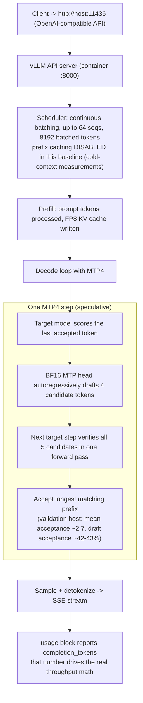
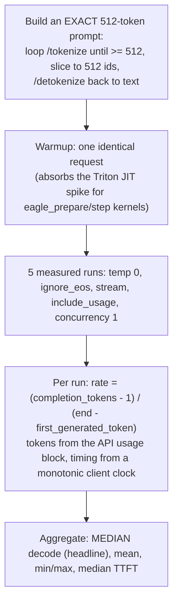
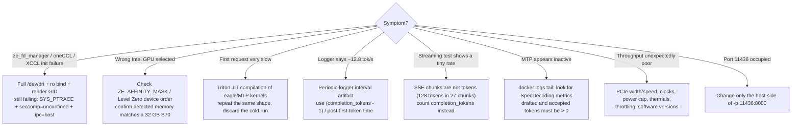

# B70 Qwen3.8 vLLM XPU Replication Guide: Visual Breakdown

Source: https://github.com/MikeCaldera/intel-arc-pro-b70-qwen38-vllm
(community replication guide, builds on the SergiioB intel-arc-pro-b70-inference-cookbook)
Captured: 2026-09-05. Companion to `inference-pipeline.md` section 2, which
documents our local instance of the same stack.

What it is: a reproducible recipe for Qwen3.8-27B GPTQ INT4 + BF16 MTP4
speculative decoding on a single Intel Arc Pro B70 32 GB using vLLM XPU in a
pinned Docker image. Headline validated result: 84.65 tok/s median decode
(p512/g128, concurrency 1).

## 1. The pinned known-good stack

Everything is pinned so a reproduction is bit-comparable. Changing any row
makes it a different benchmark configuration.

| Component | Known-good value |
|-----------|------------------|
| GPU | Intel Arc Pro B70 32 GB |
| Model | `SergiioB/Qwen3.8-27B-GPTQ-Int4-sym-G128-MTP-BF16` |
| Model revision | `9d189a60e4c0ad7f9f47cd94bfa393ca10b3924e` |
| Container image | `vllm/vllm-openai-xpu@sha256:f01e24f6c7ff...ba4f` (digest-pinned) |
| vLLM | `0.27.2rc1.dev77+gac7509e2b.xpu` |
| XPU kernels | `vllm-xpu-kernels 0.1.12.3` |
| Quantization | GPTQ INT4, symmetric, group size 128 |
| MTP | 4 speculative tokens, BF16 draft |
| KV cache | FP8 |
| Context | 131072 |
| Max sequences | 64 |
| Max batched tokens | 8192 |
| Prefix caching | Disabled in this baseline |
| GPU memory utilization | 0.88 |

Repo layout worth knowing: `benchmarks/` (extended repro + long-context),
`evidence/mtp4-context-scaling/` (verification script + SHA256SUMS for the
context-scaling datasets), `patches/` (the two MTP patch scripts),
`scripts/`, `watchdog/` (one-command installer), `windows/` (Windows port),
`Dockerfile.vllm-xpu-26.31`.

## 2. Workflow map (all 20 steps as six phases)

```mermaid
flowchart TD
  subgraph A["Phase A: Host prep (steps 2-4)"]
    A1["Prereqs: Linux + xe driver, Docker with /dev/dri access,<br/>healthy PCIe, cooling/power, storage for model + image + caches"]
    A2["Identify YOUR B70: lspci, /dev/dri, by-path, sysfs vendor/device<br/>Record: PCI address, cardX, renderDXXX, render-node GID<br/>Never copy card2 / renderD129 / 04:00.0 blindly"]
    A3["PCIe link health: LnkCap vs LnkSta<br/>Validation host ran Gen3 x16; investigate x1 before comparing perf"]
  end
  subgraph B["Phase B: Stack assembly (steps 5-7)"]
    B1["Clone upstream cookbook (SergiioB)"]
    B2["Download pinned model revision 9d189a60<br/>to /mnt/data/models/Qwen3.8-27B-GPTQ-Int4-sym-G128-MTP-BF16"]
    B3["Verify BOTH patch SHA256 hashes<br/>Mismatch = stop. Do not silently mix a newer patch into this baseline"]
    B4{"oneCCL/XCCL fails at startup?<br/>(ze_fd_manager / DRM device-dir errors)"}
    B5["Validated workaround: --cap-add SYS_PTRACE<br/>--security-opt seccomp=unconfined --ipc=host<br/>(troubleshooting aid, not assumed universal)"]
  end
  subgraph C["Phase C: Launch (step 8)"]
    C1["Export IMAGE digest, MODEL_DIR, B70_RENDER_NODE,<br/>RENDER_GID from stat on the render node"]
    C2["docker run: name qw38speed, -p 11436:8000, restart unless-stopped<br/>full /dev/dri device + ro bind + group-add<br/>model mounted ro, both patch scripts mounted ro"]
    C3["Container boot: entrypoint bash -lc<br/>run patch_mtp.py, run patch_boundary.py, then exec vllm serve"]
  end
  subgraph D["Phase D: Verify (steps 9-11)"]
    D1["docker logs -f: wait for 'Application startup complete'<br/>Good signs: XCCL ok, AutoGPTQ XPU path, MTP drafter init,<br/>XPU graph capture success, ~30.3 GiB device memory visible"]
    D2["curl /health + /v1/models must list qwen38"]
    D3["One same-shape warmup request<br/>(first request triggers Triton JIT for eagle/MTP kernels)"]
    D4["Confirm MTP is live: SpecDecoding metrics in logs<br/>drafted + accepted tokens > 0, mean acceptance ~2.7,<br/>draft acceptance ~42-43%"]
  end
  subgraph E["Phase E: Benchmark (steps 12-14)"]
    E1["Measure correctly: (completion_tokens - 1) / (end - first_token)<br/>from the API usage block + monotonic client clock<br/>NOT the periodic logger, NOT SSE chunk counts"]
    E2["p512/g128 protocol: exact 512-token prompt, one same-shape warmup,<br/>5 measured runs, concurrency 1, temp 0, ignore_eos"]
    E3["Report MEDIAN + mean + min/max decode, median TTFT"]
  end
  subgraph F["Phase F: Ops guardrails (steps 15-20)"]
    F1["Engine context on the validation host:<br/>Ollama Vulkan ~11-12, llama.cpp SYCL ~27.4, vLLM+MTP4 84.65 tok/s"]
    F2["Power cap via hwmon inspection (reference campaign: 230 W);<br/>watch temps/clocks/throttling during the run"]
    F3["Troubleshoot from the symptom table BEFORE changing tuning"]
    F4["Reproducibility checklist for any posted result<br/>(dist, kernel, xe status, PCI, PCIe gen/width, image digest,<br/>model revision, patch hashes, args, env, power cap, timing formula)"]
    F5["Preserve the baseline config before applying optimization overlays<br/>(draft INT4, MTP INT4, GDN mixed-split, newer images, util/prefix-cache<br/>changes are all different benchmark configurations)"]
  end
  A1 --> A2 --> A3 --> B1 --> B2 --> B3 --> B4
  B4 -- yes --> B5 --> C1
  B4 -- no --> C1
  C1 --> C2 --> C3 --> D1 --> D2 --> D3 --> D4 --> E1 --> E2 --> E3 --> F1 --> F2 --> F3 --> F4 --> F5
```

## 3. The launch command, decomposed

One `docker run` carries four distinct jobs. Each group below maps to a
failure mode if gotten wrong.

| Group | Items | Why it matters |
|-------|-------|----------------|
| Device isolation | `--device /dev/dri:/dev/dri`, `-v /dev/dri:/dev/dri:ro`, `--group-add $RENDER_GID`, `ZE_FLAT_DEVICE_HIERARCHY=COMPOSITE`, `ZE_AFFINITY_MASK=0` | Container must be able to open the render node; composite hierarchy presents the multi-tile B70 as one device; affinity 0 selects device 0 (verify it is actually your B70 on multi-GPU hosts) |
| Container plumbing | `--name qw38speed`, `-p 11436:8000`, `--restart unless-stopped`, `--entrypoint bash` | Host port is swappable if busy; entrypoint override is what lets patches run before `vllm serve` |
| Patch stage | Mount `patch_mtp_nightly.py` as `/patch_mtp.py`, `patch_boundary.py` as `/patch_boundary.py`; boot script runs both, then `exec vllm serve` | Fixes MTP behavior in the stock image install at container start; hashes are part of the baseline identity |
| Runtime env | `VLLM_TARGET_DEVICE=xpu`, `B70_MTP_BF16_DRAFT=1`, `VLLM_XPU_ENABLE_XPU_GRAPH=1`, `PYTORCH_ALLOC_CONF=expandable_segments:True` | XPU backend, BF16 draft head precision, graph capture, allocator fragmentation control |
| Serve flags | `--quantization gptq --dtype float16 --max-model-len 131072 --gpu-memory-utilization 0.88 --kv-cache-dtype fp8 --port 8000 --max-num-seqs 64 --max-num-batched-tokens 8192 --no-enable-prefix-caching --served-model-name qwen38 --language-model-only --speculative-config '{"method":"mtp","num_speculative_tokens":4}'` | The actual inference configuration; prefix caching deliberately off so every benchmark run is cold-context |

Container boot sequence:

```mermaid
flowchart LR
  S1["bash -lc (entrypoint override)"] --> S2["python /patch_mtp.py<br/>(MTP nightly fixes into the vLLM install)"]
  S2 --> S3["python /patch_boundary.py<br/>(MTP boundary fixes)"]
  S3 --> S4["exec vllm serve /model (flag set above)"]
  S4 --> S5["XCCL / oneCCL init<br/>(needs full /dev/dri + render GID)"]
  S5 --> S6["AutoGPTQ loads GPTQ INT4 weights via XPU path"]
  S6 --> S7["MTP drafter init (BF16 head, 4 spec tokens)"]
  S7 --> S8["XPU graph capture"]
  S8 --> S9["Application startup complete"]
```

## 4. Request path inside the running server (MTP4)

## 5. Benchmark methodology (and its two traps)

Traps the guide calls out explicitly:

- **vLLM periodic logger lies for short requests.** It reported
  "Avg generation throughput: 12.8 tokens/s" for a 128-token request because
  of its reporting interval. Not the post-first-token decode rate.
- **SSE chunks are not tokens.** One 128-token response arrived in 27 chunks;
  counting chunks gives a bogus ~17/s. Multiple tokens are coalesced per
  streaming event. Always use `completion_tokens`.

## 6. Results

### Validated p512/g128 (concurrency 1, after same-shape warmup)

| Metric | Result |
|--------|--------|
| Median decode | 84.65 tok/s |
| Mean decode | 84.49 tok/s |
| Min / Max | 83.73 / 84.78 tok/s |
| Median TTFT | 0.3557 s |
| Prompt / generation | 512 / 128 tokens |
| Measured runs | 5 |

Spread was ~1.05 tok/s min-to-max. The guide stresses this is a known-good
reference, not a guarantee: PCIe topology, CPU, drivers, power limits,
thermals, and software revisions all move the number.

### Verified MTP4 context scaling (separate procedure, cold context, prefix hits = 0)

| Prompt tokens | Median decode |
|--------------:|--------------:|
| 512 | 81.24 tok/s |
| 8,192 | 73.30 tok/s |
| 16,384 | 74.76 tok/s |
| 32,768 | 68.34 tok/s |
| 65,536 | 66.11 tok/s |
| 120,000 | 50.31 tok/s |

Note: the 84.65 figure and the 81.24 512-token point come from two different
benchmark procedures and are intentionally reported separately. All six
datasets are machine-verifiable via `evidence/mtp4-context-scaling/verify_results.py`
plus SHA256 checksums.

### Extended / long-context results

- 80K cold-context MTP2: 6/6 PASS, ~51.5 tok/s typical decode.
- 160K MTP2 on Intel compute-runtime 26.31: 3 consecutive 160K requests PASS.
- The Xe failure seen under runtime 26.27 did not reproduce on the 26.31 retest.

### Engine context on the validation host (one-host measurements, not universal)

| Stack | Format | Decode |
|-------|--------|-------:|
| Ollama Vulkan | Q4_K_M | ~11-12 tok/s |
| llama.cpp SYCL | Q4_K_M | ~27.4 tok/s |
| vLLM XPU + MTP4 | GPTQ INT4 + BF16 draft | 84.65 tok/s median |

## 7. Troubleshooting decision tree

## 8. Guardrails (the parts that make it a *reproduction* guide)

- Identify your own devices first. `card2`, `renderD129`, and `04:00.0` are
  system-specific examples, not constants.
- Patch SHA256 hashes are part of the baseline identity. If they do not
  match, stop and figure out whether upstream moved.
- Warm before measuring. The first request pays Triton JIT costs.
- Report medians over N runs, never a single best run.
- Every posted result should carry the full reproducibility checklist: dist,
  kernel, xe driver status, PCI address, negotiated PCIe gen/width, card and
  render node, affinity selection, Docker version, image digest, vLLM and
  XPU kernel versions, exact model revision, patch hashes, CLI args, env
  vars, power cap, clock/thermal state, prompt/output token counts,
  concurrency, warmup procedure, repetition count, timing formula.
- Freeze the baseline before optimizing. Draft INT4, MTP INT4, GDN
  mixed-split changes, newer images, and different util/prefix-cache settings
  are all *different configurations*; each experiment records its own image
  digest, model revision, patch set, launch command, and result.

Quick recovery sequence (condensed): identify B70 and render node, verify
PCIe, clone cookbook, confirm pinned model revision, verify patch hashes,
set `B70_RENDER_NODE`, launch with standard DRI mapping (add the oneCCL
workaround only on failure), wait for startup complete, check `/health` and
`/v1/models`, confirm the 32 GB B70 was selected, one same-shape warmup,
five p512/g128 runs, compare the median against ~84 tok/s, and if far off,
investigate environment before touching tuning.

## 9. How this maps to our fleet

Our `run-guide-docker-gpu1.sh` / container `qw38heretic` is the local
implementation of this same guide pattern. Same image family, same env levers
(`VLLM_XPU_ENABLE_XPU_GRAPH=1`, `B70_MTP_BF16_DRAFT=1`), same device-isolation
approach (we use a `renderD130` device cgroup; the guide uses
`--device`/`--group-add`). Differences that matter when comparing numbers:

| Dimension | This guide (validated) | Our TP1 stack |
|-----------|------------------------|---------------|
| Checkpoint | `SergiioB/Qwen3.8-27B-GPTQ-Int4-sym-G128-MTP-BF16` @ pinned rev | `heretic-org-Qwen3.8-27B-heretic-ara-int4-gptq` (GPTQ-restamped heretic abliteration) |
| Spec tokens | MTP4 | MTP4 (BF16 draft) |
| Prefix caching | Disabled (cold-context protocol) | Enabled |
| Power cap | 230 W reference campaign | 180 W caps |
| Port | 11436 -> 8000 | direct :8000, alias `qwen-256k` / `qwen-128k` |
| Headline number | 84.65 tok/s median (p512/g128) | 83.04 tok/s (rewritten ckpt, all-F16 MTP, @180W) |

The ~1.6 tok/s gap between 84.65 and 83.04 is consistent with the 230W vs
180W cap difference plus the different checkpoints; treat the two as the same
performance class, not as a regression.
