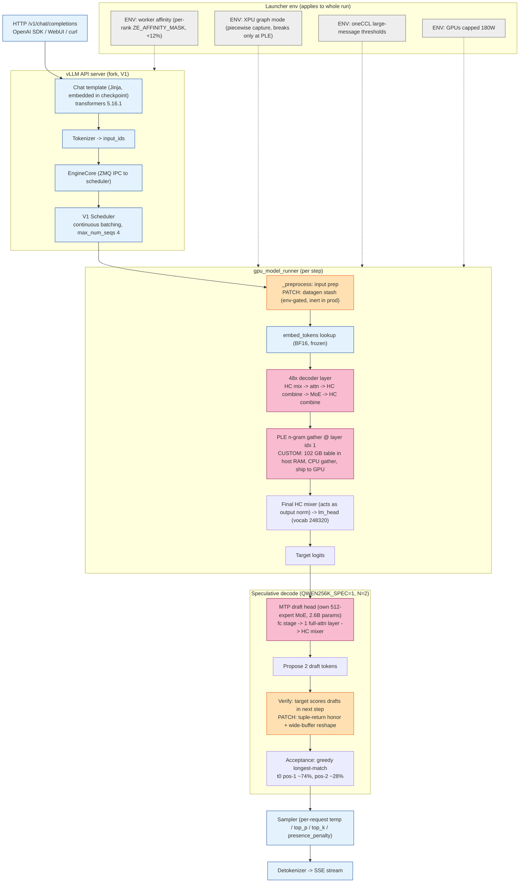
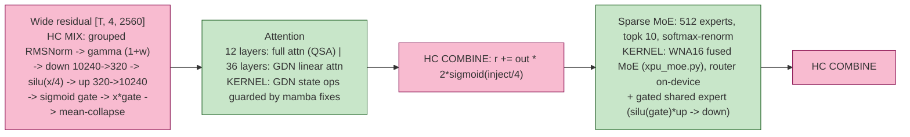
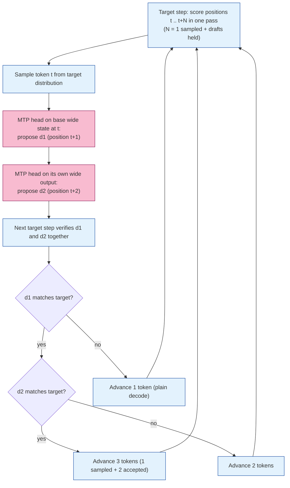
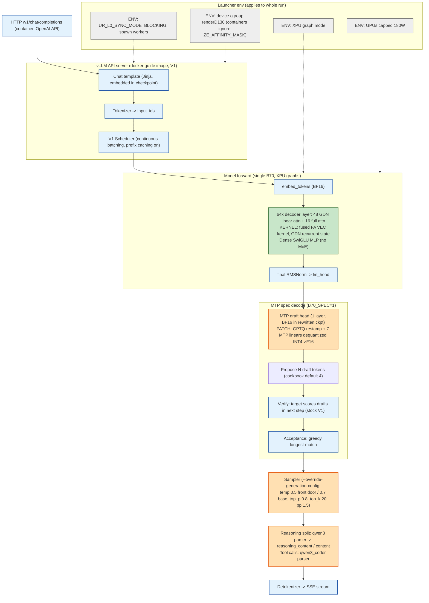
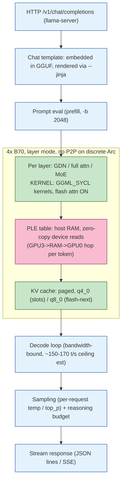
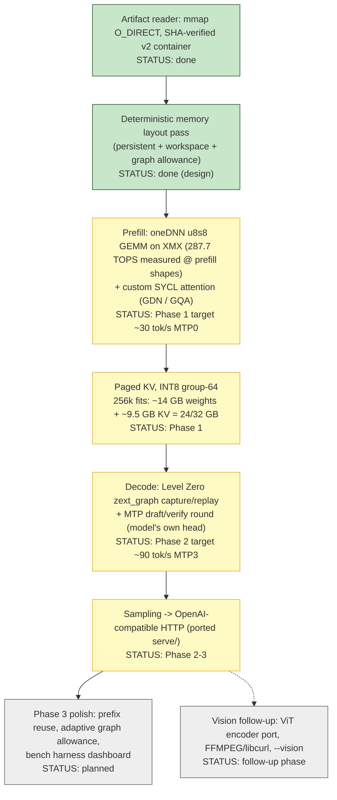

# Inference Pipeline Reference

Per-engine visualization of the full inference path: what runs at each step,
which library provides it, and where we deviate from stock. Companion data
file: `inference-pipeline.yaml` (source of truth for the diagrams).

Last updated: 2026-09-05.

## Legend

| Class | Meaning | Color |
|-------|---------|-------|
| STOCK | Upstream component, unmodified (vLLM / llama.cpp / transformers as released) | blue |
| KERNEL | Intel-provided kernel or driver layer (vllm_xpu_kernels, oneDNN/XMX, Level Zero, oneCCL) | green |
| PATCH | Locally modified upstream code (venv fork or local llama tree) | orange |
| CUSTOM | Code we wrote that does not exist upstream (qwen4exp port, PLE offload, tracer) | pink |
| ENV | Launcher environment / hardware tuning (power caps, affinity, thresholds) | gray |

---

## 1. vLLM TP4 Flash-Next (production :8000, alias `qwen-256k`)

Stack: torch 2.13.0+xpu, vLLM fork (c39076fef-era + qwen4exp port),
vllm_xpu_kernels 0.1.14.1, transformers 5.16.1, V1 runner, XPU graph mode
(`VLLM_XPU_ENABLE_XPU_GRAPH=1`). Model: Qwen3.8-Flash-Next heretic-2, 125B
MoE / 6B active, W4A16 (73 GB checkpoint), 48 layers, 256K context, fp8 KV,
TP4 + expert parallel across all four B70 cards.

**Optimized for:** `devancarlin-Qwen3.8-Flash-Next-heretic-2-W4A16-BF16src`
(checkpoint at `/mnt/data/models/`, 73 GB W4A16, `mtp.*` kept BF16 via the
quant ignore list). Every number in this section, the MTP2 default, and the
env recipe were A/B-measured on this exact artifact on 4x B70. Do not carry
these settings to another model without re-benchmarking.

### 1.1 Request lifecycle

### 1.2 One decoder layer (x48)

Full-attention (QSA) layer internals:

- `q_proj` [12288, 2560]: outputs q and gate halves (24 heads x 256 x 2).
- `k_proj` / `v_proj` [512, 2560]: 2 KV heads x 256.
- `q_norm` / `k_norm`: GemmaRMSNorm (deviation gamma `1 + w`), 256-dim.
- RoPE: neox half-split, `partial_rotary_factor 0.25` -> rotary_dim 64, rest passthrough.
- GQA 24:2 via `repeat_interleave`; SDPA causal; sigmoid output gate on q-half.
- `o_proj` [2560, 6144].
- GDN layers: gated delta-net linear attention, recurrent state sharded per rank;
  the three mamba patches guard that state under speculative rollback.

### 1.3 One decode step with MTP2

Why MTP2 wins at sampling temps: the draft step is one full-attention layer
plus a small MoE, cheap against the 48-layer target, so even a ~28% position-2
acceptance pays for itself. At greedy temp 0, MTP1 was the winner instead
(71.59 vs MTP4 66.94); the crossover comes from the same decay pattern.

### 1.4 Stage table

| Stage | Component | Provided by | Local change | Notes |
|-------|-----------|-------------|--------------|-------|
| HTTP intake | API server, OpenAI routes | vLLM fork | none | `--api-key` only when `serve/.api_key` exists |
| Chat template | Jinja template embedded in checkpoint | transformers 5.16.1 | none | Never pass an external template |
| Tokenize | HF tokenizer | transformers | none | Multimodal: Qwen3-VL processor path |
| Scheduling | V1 continuous batching | vLLM fork | none | Prefix caching disabled in datagen only |
| Input prep | `_preprocess` | vLLM fork | PATCH: datagen stash (env-gated) | Inert unless `B70_MTP_DATAGEN=1` |
| Embedding | `embed_tokens` (BF16) | qwen4exp port | CUSTOM | Frozen; never trained |
| Layers x48 | HC + attention + MoE | qwen4exp port + xpu_kernels | CUSTOM + KERNEL | See 1.2 |
| PLE gather | n-gram table, layer idx 1 | qwen4exp port | CUSTOM | 102 GB in host RAM; per-step gather is 16 rows/token |
| Output norm + head | final HC mixer, `lm_head` | qwen4exp port | CUSTOM | No separate final RMSNorm exists |
| Draft | MTP head (2.6B, own MoE) | qwen4exp port | CUSTOM + PATCH | Tuple-return + wide-buffer fixes |
| Verify/accept | V1 spec decode | vLLM fork | PATCH: mamba state guards | accepted_sync / backward_copy / eagle_drop |
| Sampling | per-request params | vLLM | none | Server default temp 0.7 |
| Serve extras | reasoning parser `qwen3`, tool parser `qwen3_xml` | vLLM | none | `--generation-config vllm` |

### 1.5 Performance anchors (p512/g128, matched bench)

| Config | tok/s |
|--------|-------|
| Baseline (stock fork, no tuning) | 52.00 |
| + oneCCL threshold vars | 52.14 (neutral) |
| + worker affinity | 58.17 (+12%) |
| MTP1, temp 0 | 71.59 |
| MTP2, temp 0 | 75.0-76.4 |
| MTP2, temp 0.5 | 69.82 (production default) |
| XPU graphs vs eager (2026-08-28) | 53.2 vs 7.0 (7.6x) |

---

## 2. vLLM TP1 Qwen3.8-27B (docker guide stack, :8000)

**Optimized for:** `heretic-org-Qwen3.8-27B-heretic-ara-int4-gptq`
(GPTQ-restamped heretic abliteration, w4g128, ~18 GB, stored on home `/`).
Single B70 (GPU0 default, `renderD130` via device cgroup), container
`qw38heretic`, served as `qwen-256k` (or `qwen-128k` through the front
door). Shares `:8000` + alias with the Flash-Next vLLM launcher; only one
of the two runs at a time. All numbers below were measured on this exact
checkpoint + container image.

Stack: vLLM XPU docker guide image (`run-guide-docker-gpu1.sh`), V1 runner,
XPU graph mode (`VLLM_XPU_ENABLE_XPU_GRAPH=1`), 128K context (front-door
default), fp8 KV, `gpu_memory_utilization 0.90`, GPUs capped 180W. Model:
Qwen3.8-27B dense hybrid (48 Gated-DeltaNet linear-attention layers + 16
full-attention layers, 3:1 pattern), 256K native context, one MTP layer,
vision tower present but disabled via `--language-model-only`
(`B70_VISION=1` enables up to 4 images).

### 2.1 Request lifecycle

### 2.2 Recent optimizations (2026-09-04/05)

1. **GPTQ restamp rewrite** (`rewrite_heretic_to_gptq.py`). Root cause of
   earlier garbage output: AutoRound stamps route vLLM to the `inc` /
   auto_round_kernel backend, which mis-decodes W4A16 g128 weights on this
   XPU build. The rewrite re-stamps `config.json` to true GPTQ (byte-
   identical tensor packing, no requantize) and dequants the 7 MTP decoder
   linears INT4 -> F16 so the draft head matches the base precision.
2. **BF16 MTP draft** (`B70_MTP_BF16_DRAFT=1`, `DRAFT_INT4=0` on the
   rewritten checkpoint). Keeps the draft head all-F16 like the base:
   83.04 vs 81.46 tok/s with the INT4 draft overlay.
3. **Reasoning + tool parsers** (`--reasoning-parser qwen3
   --enable-auto-tool-choice --tool-call-parser qwen3_coder`). Before this,
   raw thinking leaked into `content` and burned `max_tokens`. These
   checkpoints emit no opening `<think>` tag; the qwen3 parser starts in
   REASONING state and splits on `</think>` alone.
4. **Interactive front door** (`start-qwen-128k.sh`): numbered menu over
   the guide launcher (model, GPU, port, ctx, sampling, spec decode,
   vision, API key).
5. **XPU graph mode + 180W caps**: same levers as the TP4 stack.

### 2.3 Stage table

| Stage | Component | Provided by | Local change | Notes |
|-------|-----------|-------------|--------------|-------|
| HTTP intake | API server, OpenAI routes | docker guide image | none | keyless or `serve/.api_key` |
| Chat template | Jinja template embedded in checkpoint | transformers in image | none | Never pass an external template |
| Tokenize | HF tokenizer | transformers | none | Vision off via `--language-model-only` |
| Scheduling | V1 continuous batching | vLLM | none | Prefix caching on |
| Weights | GPTQ w4g128 (restamped) | `rewrite_heretic_to_gptq.py` | CUSTOM | AutoRound stamps garble on the XPU `inc` backend |
| Layers x64 | GDN / full attn + dense SwiGLU | vLLM qwen3_5 impl + xpu kernels | KERNEL | GDN state trivially local at TP1 |
| Output | final RMSNorm + `lm_head` | vLLM | none | |
| Draft | MTP head (1 layer, BF16) | model weights | PATCH (dequant) | `B70_MTP_BF16_DRAFT=1` |
| Verify/accept | V1 spec decode | vLLM | none | Stock V1 measured clean at TP1; the mamba fixes live in the venv fork (Flash-Next path) |
| Sampling | per-request params | vLLM | PATCH: `--override-generation-config` | temp 0.5 (front door) / 0.7 (base) |
| Reasoning/tools | qwen3 + qwen3_coder parsers | vLLM | PATCH (2026-09-04) | Splits thinking from answer |

### 2.4 Performance anchors (p512/g128, @180W)

| Config | tok/s |
|--------|-------|
| Rewritten GPTQ ckpt, all-F16 MTP (current) | 83.04 |
| Draft-INT4 overlay | 81.46 |
| BF16 draft, pre-rewrite baseline | 54.15 |

### 2.5 venv fallback variant

`serve/fallback/start-qwen.sh`: same model family (devan-carlin heretic-ara
int4 AutoRound) on the venv stack instead of the container image: 128K,
fp8 KV, prefix caching, keyless `--api-key` from `serve/.api_key`, tool
parser `qwen3_coder`, `--override-generation-config`. Use it when you need
the venv (testing fork changes) rather than the docker image.

---

## 3. llama.cpp SYCL (swarm slots + flash-next)

Stack: local llama.cpp tree (pr-27742 branch, since merged upstream), built
with `icpx` 2026.1, `GGML_SYCL=ON`. `llama-server` exposes an
OpenAI-compatible API, no auth. All slots run `-np 1` (single stream, keeps
KV on-GPU), thinking ON (`--reasoning on --reasoning-format deepseek
--reasoning-budget 2048`).

Slots:

| Port | Alias | Model | KV | Decode |
|------|-------|-------|----|--------|
| 8088 | `qwen` | Qwen3.6-35B-A3B Aggressive (Q4_K_P, MoE 35B/3B-active) | q4_0 | ~80 tok/s |
| 8089 | `gemma` | Gemma4 26B-A4B Balanced (Q4_K_P) | q4_0 | ~54 tok/s |
| 8090 | `flash-next` | Qwen3.8-Flash-Next UD-Q4_K_XL (125B) | q8_0 | 27.28 tok/s |

Env (from `llama/set-env.sh` + launch scripts): `ONEAPI_DEVICE_SELECTOR=
level_zero:0,1,2,3`, `ZES_ENABLE_SYSMAN=1`, `GGML_SYCL_ENABLE_FLASH_ATTN /
OPT / DNN / MKL_FA=1`, `GGML_SYCL_FA_ONEDNN_MAX_KV=65536`,
`UR_L0_ENABLE_RELAXED_ALLOCATION_LIMITS=1`, `LLAMA_ATTN_ROT_DISABLE=1`
(required for q8_0 KV).

Local-tree changes to preserve: `tools/CMakeLists.txt` actdump hook,
`tools/actdump/` activation-dump tool (vLLM-vs-llama parity loop). MTP
self-speculation is wired in the build (PR #27742) and available behind the
launcher toggle.

---

## 4. NX (target engine, `ninfer-sycl/`)

From-scratch C++ / SYCL 2020 (icpx, Level Zero) reimplementation of the NInfer
architecture on one B70. Closed-set `.ninfer` artifacts (v2 container:
weights + frontend resources). No PyTorch in the hot path. Target model:
Qwen3.8-27B (64 layers: 16 full-attn + 48 GDN), mixed groupwise-int weights
(Q4G64 MLP gate/up, Q5G64 down/proj, W8G32 embed/head/MTP, BF16 norms),
packed 16.95 GiB.

Key decisions (locked in `PORTING_NOTES.md`):

- XMX is INT8-only: keep int4 storage, dequant to int8 in-kernel. True int8
  (28.2 GB) would not fit with 256k KV.
- oneDNN is the only reliable XMX GEMM path; raw SYCL cannot address XMX.
- Week-0 microbenchmarks all green: GEMM TOPS, graph capture round-trip,
  raw bandwidth ~450+ GB/s.
- Definition of done: 80-110 tok/s MTP3 at C=1, 256k context, graph capture
  active on decode, validated token-by-token against IPEX.

---

## 5. Cross-engine comparison

| Dimension | vLLM TP4 (Flash-Next) | vLLM TP1 (27B) | llama.cpp SYCL | NX (target) |
|-----------|----------------------|----------------|----------------|-------------|
| GPUs | 4 (TP4 + EP) | 1 | 4 (layer mode) or 1 | 1 |
| Models | 125B W4A16 | 27B GPTQ w4g128 (heretic) | 27B / 35B-A3B / Gemma / 125B GGUF | 27B (closed set) |
| Context | 256K (fp8 KV) | 128K (fp8 KV, 256K native) | 256K (q4_0 / q8_0 KV) | 256K (INT8 group-64 KV) |
| Spec decode | MTP (wired, default N=2) | MTP (B70_SPEC=1, BF16 draft) | MTP (build-wired, toggle) | MTP native (Phase 2) |
| Graphs | XPU piecewise capture | XPU graph mode | n/a (eager kernels) | Level Zero zext_graph |
| Concurrency | max_num_seqs 4 | GUIDE_MAX_NUM_SEQS (default 64) | np=1 per slot | C=1 first, C=8 later |
| Host | venv fork | docker guide image | local llama tree | from-scratch SYCL |
| Best for | Quality ceiling, vision, tools | Always-on single-card 27B, WebUI front door | Swarm throughput | Fastest single-card 27B |
| State | Production | Production (docker) | Production | Microbenchmarks green, no engine code yet |

## 6. Local modification inventory

| Modification | Where | Effect | Kill switch |
|--------------|-------|--------|-------------|
| Worker affinity (per-rank `ZE_AFFINITY_MASK` at spawn) | vLLM fork worker spawn | +12% (52.00 -> 58.17) | `B70_WORKER_AFFINITY=0` |
| Mamba accepted_sync | V1 runner | GDN state sync under spec decode | `B70_FIX_ACCEPTED_SYNC=0` |
| Mamba backward_copy (3 sites) | V1 runner | State copy on draft rejection | `B70_FIX_BACKWARD_COPY=0` |
| Mamba eagle_drop | V1 runner | Drop unused draft states | `B70_FIX_EAGLE_DROP=0` |
| MTP tuple-return honor | `llm_base_proposer.py` | `qwen4_exp_mtp` arch recognized | folded into port |
| MTP wide-buffer reshape | `qwen4_exp_mtp.py` | Return `(collapsed, wide)` for step 2+ | folded into port |
| `get_mtp_target_hidden_states` wrapper hook | `qwen4_exp.py` | 2560-wide -> 10240-wide drafter buffer fix | folded into port |
| PLE host-RAM offload | qwen4exp port | 102 GB table in system RAM, CPU gather | core to port |
| Datagen tracer v5 | runner + `qwen4_exp.py` | Wide-state capture to disk | `B70_MTP_DATAGEN=0` (inert in prod) |
| oneCCL large-message thresholds | launcher env | Neutral within noise, shipped | remove vars |
| XPU graph mode | launcher env | 7.6x over eager | `VLLM_XPU_ENABLE_XPU_GRAPH=0` |
| GPU power caps 180W | systemd service | Thermal/acoustic control | `install-power-caps-service.sh` |
| `LLAMA_ATTN_ROT_DISABLE=1` | llama env | Required for q8_0 KV stability | remove var |
| actdump tool | local llama tree | Activation dumps for parity loop | build-time |

## 7. Related docs

- `architecture.md` : fleet topology, hardware, runtime paths.
- `swarm-architecture.md` : two-machine harness design.
- `SERVICES.md` / `HANDOFF.md` : operator views of the live stack.
- `ninfer-sycl/PORTING_NOTES.md` : NX running log (measured numbers).
- `b70-qwen38-replication-guide-breakdown.md` : visual breakdown of the
  community B70 Qwen3.8 vLLM XPU replication guide (MikeCaldera repo).
- `ninfer-sycl/intel-arc-kickoff-prompt.md` : NX build order + constraints.
- `electric-sheep/BACKLOG.md` : MTP A/B history, parked head re-fit.
